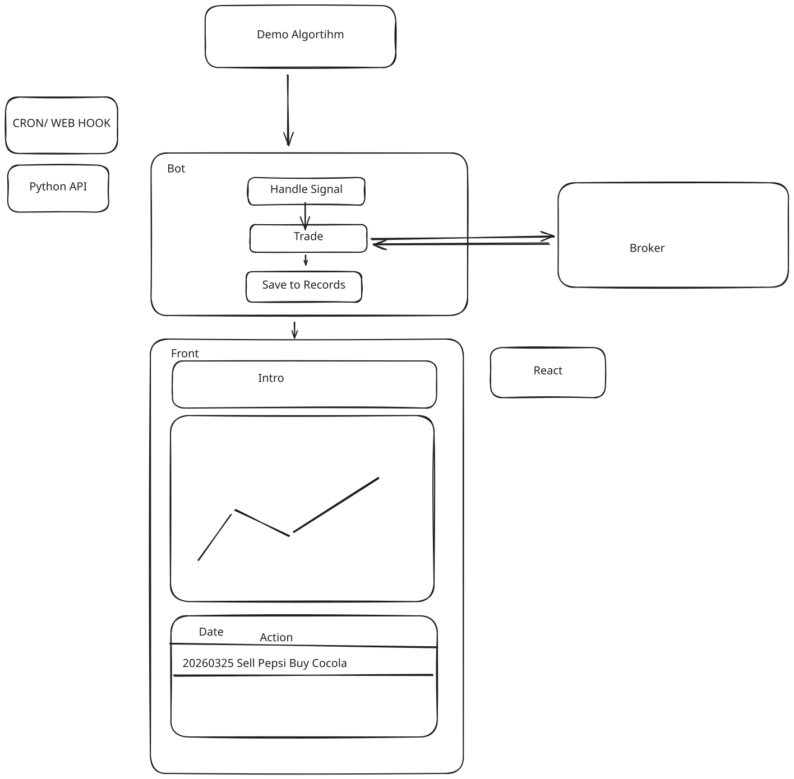

## TradeInsight Trading Bot

A single web application that receiving trading signals through webhook, make the trade requests to broker and display the trade records and performance in a front-end application.

## Purpose

To receive trading signals, make the trade requests to broker and display the trade records and performance in a front-end. 

## Stacks and Architecture
- Flack to build the backend api
- React to get the UI built
- Alpaca for testing trading broker

## Workflow

### Data:

1. Our demo algorithm has a new signal output (Target Portfolio), this will be received through webhook in out bot BE api endpoint
2. BE Bot endpoint will do the calculation
    1. Current portfolio position
    2. Target portfolio position
    3. Calculate the difference and send the trading requests to broker
    4. Save this to a db table

### User:
1. Visit React page
2. Consume data from BE endpoint `/delta`
    1. Send the latest record timestamp of the FE cache
        1. We can use localstorage for caching the data and benchmark data too
    2. BE return the all delta trading records
3. Consume data from BE endpoint `/benchmark`
    1. Send a ticker
        1. `QQQ`, `SPY`, `QQQ + GLD + BIL`
    2. Send latest record timestamp
4. Render the chart with benchmark and algorithm performance
5. Render the table too