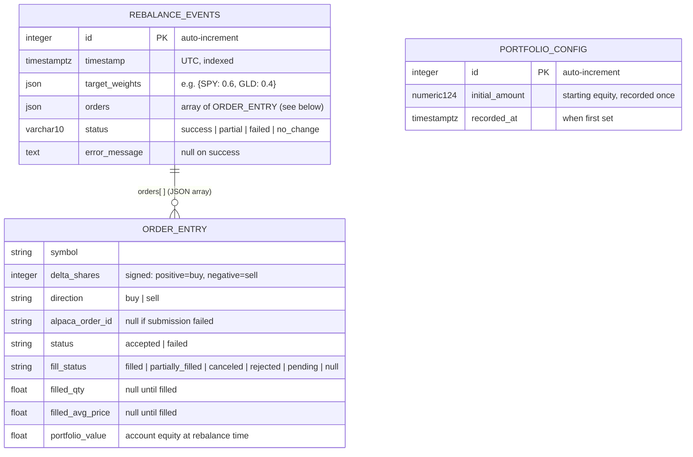

# Entity Relationship Diagram

## Notes

- `ORDER_ENTRY` is not a physical table — it is stored as a JSON array in `rebalance_events.orders`.
- `PORTFOLIO_CONFIG` is a single-row table used as the baseline for the performance chart.
- No foreign key between `REBALANCE_EVENTS` and `PORTFOLIO_CONFIG` — both are read independently by the `/benchmark` endpoint to reconstruct the bot equity curve.
